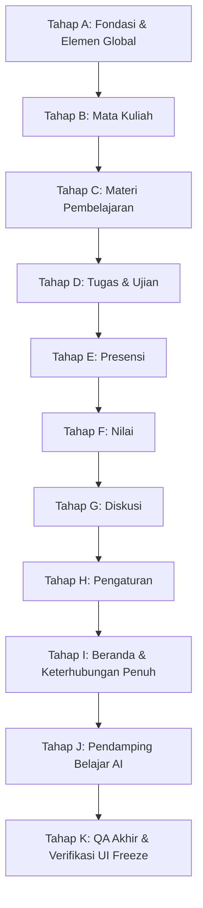

# Rencana Implementasi Wiring Arunika LMS (Portal Mahasiswa)
*Transformasi Tampilan Statis Menjadi Fitur Nyata, Terhubung, dan Konsisten*

Dokumen rencana arsitektur dan eksekusi teknis untuk menghubungkan seluruh tampilan Mahasiswa (8 halaman + Topbar/Sidebar global) ke database, aksi nyata, dan state terpadu, dengan kepatuhan mutlak pada **UI Freeze (Nol Perubahan Visual)**.

---

## 1. Arsitektur Wiring

### 1.1 Pola Implementasi (Sesuai Gaya Repo yang Ada)
- **Controller + Blade + Alpine.js**: Konsisten dengan pola yang telah berjalan di repository saat ini.
- **Satu Sumber Kebenaran (Single Source of Truth)**: Seluruh angka, persentase, IPK, dan progres dihitung murni di Service Layer / Query Class. Tidak ada kalkulasi logika bisnis di Blade view.
- **State Semester Global**:
  - `active_term_id` dikelola melalui session dan dipersistensi ke `user_preferences`.
  - Dropdown semester di Beranda, Mata Kuliah, dan Nilai otomatis tersinkronisasi.
- **Route Model Binding & Autorisasi Berlapis**:
  - URL publik/resource menggunakan ULID (`string ulid, 26`).
  - Scoped policy ke enrollment mahasiswa aktif untuk mencegah Insecure Direct Object References (IDOR).
  - Mahasiswa hanya dapat mengakses materi, tugas, dan nilai dari kelas yang sah diikutinya.
- **Keamanan Form & Idempotensi**:
  - Validasi menyeluruh via FormRequest.
  - Database Transactions (`DB::transaction`) untuk operasi multi-tabel (misal: submit tugas -> simpan file -> catat submission -> catat XP ledger -> buat notifikasi).
  - Tombol disabled saat proses submit untuk mencegah double-post.
- **Penyimpanan Waktu & Lokalisasi**:
  - Timestamp disimpan murni dalam UTC di database.
  - Ditampilkan sesuai zona waktu (`Asia/Jakarta`) dan format preferensi pengguna melalui Date Helper terpadu `ArunikaDate::format($timestamp)`.
- **Pemberantasan N+1 Query**:
  - `Model::preventLazyLoading(! app()->isProduction())` aktif di environment lokal.
  - Eager loading terarah (`with([...])`) pada semua controller dan service.

---

## 2. Model & Migrasi Database Baru

Untuk mendukung seluruh fungsionalitas yang dispesifikasikan tanpa merusak skema yang sudah ada:

1. **`grade_scales`**:
   - Kolom: `id`, `campus_id`, `letter` (A, A-, B+, dst), `min_score`, `max_score`, `gpa_point` (4.00, 3.75, dst), `is_passing`, `description`.
   - Model: `GradeScale`.
2. **`material_progress`**:
   - Kolom: `id`, `user_id`, `material_id`, `status` (`completed`, `in_progress`, `not_started`), `watch_percentage` (untuk video), `completed_at`.
   - Model: `MaterialProgress`.
3. **`discussion_categories`**, **`discussion_threads`**, **`discussion_replies`**:
   - Kolom thread: `id`, `ulid`, `class_id`, `user_id`, `category_id`, `title`, `content`, `attachment_path`, `is_pinned`, `is_locked`, `views_count`, `created_at`.
   - Kolom reply: `id`, `ulid`, `thread_id`, `user_id`, `parent_id` (nested 1-level), `content`, `is_solution`, `upvotes_count`.
   - Models: `DiscussionCategory`, `DiscussionThread`, `DiscussionReply`.
4. **`certificates`**:
   - Kolom: `id`, `ulid`, `user_id`, `course_id`, `certificate_number`, `title`, `final_score`, `letter_grade`, `issued_date`, `verification_code`, `pdf_path`.
   - Model: `Certificate`.
5. **`user_preferences`**:
   - Kolom: `id`, `user_id`, `active_term_id`, `theme` (`light`, `dark`, `auto`), `font_size` (`small`, `normal`, `large`), `locale` (`id`, `en`), `timezone`, `date_format`, `time_format`, `notification_settings` (JSON: class, deadline, messages, discussion, system).
   - Model: `UserPreference`.
6. **`support_tickets`**:
   - Kolom: `id`, `ulid`, `user_id`, `subject`, `category`, `message`, `attachment_path`, `status` (`open`, `in_progress`, `resolved`), `created_at`.
   - Model: `SupportTicket`.

---

## 3. Service Layer & Domain Events

### 3.1 Service Layer Terpusat (`app/Services/`)
- **`AcademicTermService`**: Mengelola semester aktif, riwayat semester, dan kuota SKS.
- **`CourseProgressService`**: Menghitung progres materi per mata kuliah (selesai / total) dan status pembukaan bab.
- **`AssignmentService`**: Menghitung tile tugas aktif, tenggat terdekat, filter, dan kalender mini.
- **`SubmissionService`**: Memproses pengerjaan, validasi berkas, draft, dan pengumpulan tugas.
- **`ExamService`**: Mengatur timer sesi ujian, auto-save jawaban, dan auto-grading soal objektif.
- **`GradeService`**: Menghitung nilai akhir berbobot, konversi huruf mutu, IPS, IPK riwayat, distribusi donut, dan grafik performa.
- **`AttendanceService`**: Menghitung rekapitulasi kehadiran, generator token HMAC QR 15 detik, check-in kode, dan pengajuan izin/sakit.
- **`XpService`**: Pencatatan mutasi XP di `xp_ledgers`, kalkulasi level mahasiswa, dan evaluasi lencana (badge).
- **`NotificationService`**: Pengiriman notifikasi berbasis preferensi dan agregasi notifikasi belum dibaca.
- **`DiscussionService`**: Pengelolaan thread, sanitasi XSS, popularitas skor algoritma, upvote, dan jawaban terbaik.
- **`SearchService`**: Pencarian multi-kategori (MK, Materi, Tugas, Diskusi) dengan debounce dan filter hak akses.
- **`PreferenceService`**: Penyimpanan dan pembacaan konfigurasi personalisasi mahasiswa.

### 3.2 Domain Events & Listeners (`app/Events/` & `app/Listeners/`)
| Domain Event | Listener | Dampak Pembaruan |
| :--- | :--- | :--- |
| **`MaterialCompleted`** | `UpdateCourseProgress`, `AwardXp` | Progres materi bertambah, XP diberikan, membuka materi berikutnya jika ada prasyarat. |
| **`AssignmentSubmitted`** | `LogSubmissionActivity`, `AwardXp`, `NotifyLecturer` | Status tugas berubah ke 'Terkumpul', tile statistik Beranda terupdate, notifikasi ke dosen pengampu. |
| **`SubmissionGraded`** | `CalculateGradeAggregate`, `NotifyStudentGrade`, `AwardBonusXp` | Nilai komponen terisi, kalkulasi ulang IPS sementara, feed pengumuman nilai, bonus XP nilai tinggi. |
| **`AttendanceRecorded`** | `UpdateAttendanceStats`, `AwardAttendanceXp`, `UpdateStreak` | Persentase presensi Beranda bertambah, streak harian bertambah, XP dicatat. |
| **`GradePublished`** | `FinalizeCourseGrade`, `InvalidateGradeCache`, `IssueCertificate` | Nilai menjadi final, KHS terupdate, menerbitkan sertifikat jika syarat lulus terpenuhi. |
| **`DiscussionPosted`** | `UpdateDiscussionStats`, `NotifyMentionedUsers` | Counter statistik diskusi bertambah, notifikasi dikirim ke mahasiswa/dosen terkait. |
| **`PreferenceChanged`** | `ApplyUserPreferences` | Sesi tema, bahasa, dan format tanggal seketika disesuaikan. |

---

## 4. Tahapan Pengerjaan Rinci (Tahap A s/d Tahap K)

Sesuai instruksi, pengerjaan dilakukan per tahap. Setiap tahap diselesaikan, diuji, diverifikasi terhadap baseline visual, dilaporkan, dan menunggu persetujuan sebelum berlanjut ke tahap berikutnya.

### Tahap A: Fondasi + Elemen Global
1. Pindah koneksi default ke MySQL (`DB_CONNECTION=mysql`, DB: `arunika`, `utf8mb4_unicode_ci`).
2. Jalankan migrasi tabel baru (`grade_scales`, `material_progress`, `discussions`, `user_preferences`, `support_tickets`, `certificates`).
3. Buat Seeder Baru berbasis `docs/data-canon.md` (Mahasiswa Arya Pratama, tanggal relatif terhadap `now()`, riwayat semester 1-2).
4. Buat helper tanggal terpadu (`ArunikaDate`), global semester state middleware/session.
5. Setup file lang (`lang/id` & `lang/en`) dengan string teks 100% identik dengan tampilan saat ini.
6. Wiring Topbar: Modal Pencarian `Ctrl+K` dengan debounce, lonceng notifikasi real-time + dropdown 10 notifikasi, menu dropdown profil (Profil, Pengaturan, Keluar via POST).
7. Halaman error 403, 404, 419, 500 dengan konsistensi gaya Navy Academic.

### Tahap B: Mata Kuliah
1. Implementasi `CourseService` untuk kalkulasi 5 stat tiles ringkasan (Total MK, SKS Total, SKS Diambil, MK Aktif, MK Selesai).
2. Sinkronisasi dropdown semester ke session global.
3. Filter tab (Semua, Aktif, Selesai, Arsip) dan pencarian instan nama/kode.
4. Kartu mata kuliah dinamis dari database (jadwal, ruang, dosen, progress materi).
5. Halaman baru: Detail Mata Kuliah (`/app/courses/{class}`) dan Ruang Kelas Virtual (`/app/courses/{class}/classroom`).
6. Proteksi kartu terkunci "Akan Datang" (IF2106): tombol disabled dan pembatasan akses di server.

### Tahap C: Materi Pembelajaran
1. Header MK dinamis (Kode, nama, semester, kelas, progres materi persentase).
2. Filter jenis materi (Modul, Video, Tugas, Kuis, Referensi) dan filter status.
3. Akordeon bab dinamis dengan nomor urut, deskripsi, dan penghitung materi selesai/total.
4. Halaman baru: Viewer Materi (`/app/materials/{material}/view`) untuk PDF, pemutar video dengan tracking progress $\ge 90\%$, dan tautan referensi.
5. Penguncian materi bersyarat ditegakkan di server.
6. Ringkasan materi (Total, Selesai, Proses, Terkunci) dan feed aktivitas pembelajaran terbaru dari database.

### Tahap D: Tugas & Ujian
1. 4 Tile metrik interaktif (Tugas Aktif, Ujian Mendatang, Tugas Selesai, Tugas Terlambat) yang dapat diklik untuk memfilter daftar.
2. Filter tab (Semua, Tugas, Ujian, Terlambat), sorting, dan date-range filter.
3. Unduh berkas soal lampiran via signed URL dan unduh kalender (.ics).
4. Halaman baru: Pengerjaan Tugas (`/app/assignments/{assignment}/submit`) dengan form unggah multi-berkas, simpan draft, rubrik baca-saja, dan riwayat revisi.
5. Halaman baru: Detail & Pengerjaan Ujian (`/app/quizzes/{quiz}/attempt`) dengan countdown timer di server, auto-save jawaban, dan pencegahan kecurangan.
6. Mini kalender interaktif dengan dot deadline dan klik tanggal untuk memfilter list.

### Tahap E: Presensi
1. Rekapitulasi kehadiran semester (Kehadiran %, Hadir, Izin/Sakit, Alpa) dan breakdown per mata kuliah.
2. Sistem QR Presensi Dinamis dengan token HMAC (rotasi tiap 15 detik) + fallback input kode 6 digit.
3. Pengajuan izin / sakit disertai bukti upload dokumen/surat dokter.
4. Sinkronisasi log presensi ke Beranda, penambahan XP dan streak harian mahasiswa.

### Tahap F: Nilai
1. 4 Tile metrik (IPS semester, selisih semester lalu, SKS kuota, MK Dinilai, MK Belum Selesai).
2. Sinkronisasi tab semester 1–8 dan tabel transkrip perkuliahan.
3. Kalkulasi nilai akhir berbobot (Tugas 25%, Kuis 15%, Presensi 10%, UTS 25%, UAS 25%), huruf mutu, dan IPS/IPK.
4. Donut chart 6 kelompok legenda dari `config/grading.php` dan grafik riwayat performa IPS.
5. Halaman baru: Detail Transkrip Nilai MK (`/app/grades/{enrollment}`) beserta unduh transkrip/KHS PDF.

### Tahap G: Diskusi
1. Filter tab kategori (Semua, Forum Kelas, Tanya Jawab, Pengumuman, Topik Populer) dan pencarian topik.
2. Composer tulis diskusi cepat dengan validasi, proteksi sanitasi XSS, dan rate limit.
3. Daftar thread diskusi dinamis dengan avatar asli/inisial, pin badge, badge kategori, dan hitungan view unik.
4. Halaman baru: Detail Thread Diskusi (`/app/discussions/{thread}`) dengan komentar bertingkat, upvote, dan penanda jawaban terbaik.
5. Statistik diskusi dan widget 5 diskusi terpopuler berdasarkan algoritma skor interaksi.

### Tahap H: Pengaturan
1. Sub-navigasi scroll-spy ke kartu pengaturan dan penanganan sub-halaman sekunder.
2. Informasi Profil: edit nama & verifikasi email via pensil, unggah foto profil (crop/resize 512px) yang langsung sinkron ke seluruh avatar aplikasi, alur ajukan perubahan NIM/Prodi.
3. Keamanan: Modal Ubah Password dengan validasi hash, toggle 2FA TOTP dengan verifikasi QR code & backup codes, integrasi tombol Google SSO.
4. Preferensi Notifikasi: 5 sakelar toggle auto-save via AJAX dengan toast konfirmasi.
5. Tampilan & Lokalisasi: Switch Tema (Terang/Gelap/Auto) tanpa kedip, pengaturan ukuran teks root font-size, dan pengaturan Bahasa/Timezone/Format Tanggal.
6. Form Tiket Bantuan "Hubungi Support" yang tersimpan ke database.

### Tahap I: Beranda (Keterhubungan Penuh)
1. Sambungkan banner sapaan dinamis dan tautan ke halaman jadwal mingguan (`/app/schedule`).
2. Blok Mata Kuliah Hari Ini sesuai jadwal hari ini dengan akses ke ruang kelas.
3. Tugas Terbaru dengan badge hitungan hari relatif yang akurat.
4. Ringkasan Akademik dan Capaian CPL terhubung ke Service Grade dan OBE.
5. Sertifikat & Kompetensi terhubung ke data riil dengan tautan ke viewer PDF dan verifikasi publik (`/verifikasi/{code}`).
6. Buku Besar XP terhubung ke audit log transaksional XP ledger.

### Tahap J: Pendamping Belajar AI
1. Sambungkan slide-over AI ke `AiProvider` (Gemini API) dengan fallback teruji.
2. Retrieval-Augmented Generation (RAG) berbasis silabus dan materi kuliah yang sedang aktif.
3. Penegakan Socratic Mode (bimbingan penalaran tanpa membocorkan jawaban langsung).
4. Guardrail anti-bocor ujian dan pencatatan audit pemakaian di `ai_usage_logs`.

### Tahap K: QA Akhir & Verifikasi UI Freeze
1. Uji menyeluruh seluruh skenario keterhubungan (masuk kelas -> selesaikan materi -> kumpulkan tugas -> dosen menilai -> nilai & IPK & Beranda terupdate).
2. Verifikasi Visual Freeze: Screenshot 8 halaman pada viewport 1658x949 dan bandingkan pixel-by-pixel dengan baseline `docs/baseline/`.
3. Verifikasi Git Diff: Tidak ada perubahan atribut class Tailwind atau urutan elemen.
4. Pengujian Otomatis: 14 test lama lulus + seluruh feature test baru lulus.
5. Audit Kualitas: Laravel Pint (PSR-12 bersih), Larastan tanpa error, tanpa N+1 query.

---

## 5. Rencana Pengujian Otomatis & Skenario Ujung ke Ujung

Setiap tahap dilengkapi dengan Feature & Unit Test (Pest):
- `tests/Feature/CourseFlowTest.php`: Alur pendaftaran, filter semester, progres materi.
- `tests/Feature/AssignmentFlowTest.php`: Submit tugas, validasi lampiran, pencegahan double submit.
- `tests/Feature/AttendanceQrTest.php`: Rotasi token HMAC, validasi batas waktu 15 detik, pencegahan duplikat absen.
- `tests/Feature/GradeCalculationTest.php`: Uji presisi rumus bobot, penentuan huruf mutu, IPS, dan IPK.
- `tests/Feature/DiscussionFlowTest.php`: Pembuatan thread, sanitasi XSS, komentar, upvote, dan jawaban terbaik.
- `tests/Feature/SettingsPreferenceTest.php`: Simpan preferensi, ganti password, aktivasi 2FA TOTP.
- `tests/Feature/EndToEndStudentFlowTest.php`: Uji keterhubungan menyeluruh:
  $$\text{Selesaikan Materi} \longrightarrow \text{Submit Tugas} \longrightarrow \text{Dosen Menilai} \longrightarrow \text{Nilai Final Terbit} \longrightarrow \text{KHS \& IPK Terupdate} \longrightarrow \text{XP Ledger Bertambah}$$

---

## 6. Analisis Risiko & Strategi Mitigasi

| Risiko Potensial | Dampak | Strategi Mitigasi |
| :--- | :---: | :--- |
| **Pergeseran Visual (Visual Drift)** | Tinggi | Viewport di-lock di 1658x949. Baseline screenshot sudah disimpan di `docs/baseline/`. Setiap tahap di-compare visualnya dan git diff diperiksa secara ketat. |
| **Inconsistency Data Antar Halaman** | Tinggi | Seluruh query mengacu mutlak pada `docs/data-canon.md`. Satu nama dosen per MK, satu skala nilai, dan semua tanggal relatif terhadap `now()`. |
| **Kerusakan Test Lama (14 Test)** | Kritis | Seluruh rute lama, role switcher, dan seeder dasar tetap dipertahankan kompatibilitasnya. Test lama dijalankan berkala di setiap tahap. |
| **Masalah I/O di OneDrive / Windows** | Sedang | Tetap menggunakan Windows junction link untuk `bootstrap/cache` dan `storage` agar bebas dari masalah permission lock. |
| **IDOR pada File Submission / Materi** | Tinggi | Validasi kepemilikan resource via Laravel Policy di setiap controller dan signed temporary URL untuk unduhan berkas. |
